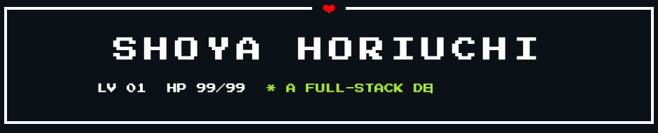
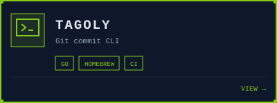
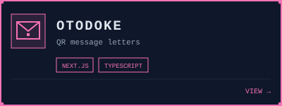
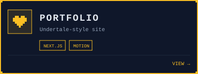

  

<!-- 

  

 -->

  
  
  
  

  

  

## ✦ PROJECTS

  
  &nbsp;
  
  &nbsp;
  

## 01. SYSTEM

I am a Full-Stack Developer striving to become a globally competitive professional. Fully proficient in English and Japanese, I thrive in international environments where communication is as vital as technical execution. I am a lifelong learner, dedicated to evolving my skills to meet global standards.

## 02. ROUTE

- Type-Safe Velocity: Rapid, reliable development with **Go**, **Java**, and **TypeScript**.
- Global Collaboration: Bilingual proficiency (EN/JP) for seamless team alignment.
- Maintainable Design: Building clean, scalable architectures with a focus on DX.
- OSS Ambition: Goal to create open-source tools used by developers worldwide.

## 03. STATS

<!-- it was under construction like posed by owner 503 -->
<!-- We can add maybe later -->
<!-- 

  
  

 -->

  <picture>
    <source media="(prefers-color-scheme: dark)" srcset="https://raw.githubusercontent.com/meso1007/meso1007/output/github-snake-dark.svg" />
    <source media="(prefers-color-scheme: light)" srcset="https://raw.githubusercontent.com/meso1007/meso1007/output/github-snake.svg" />
    
  </picture>

## 04. SKILLS

### [ BACKEND ]

**Languages:** Java / Spring Boot, Go, Python

**Data & Messaging:** Oracle, PostgreSQL, Redis, RabbitMQ

### [ FRONTEND ]

**Languages:** TypeScript, JavaScript

**Frameworks:** Next.js, Nuxt.js, Vue.js

### [ INFRASTRUCTURE / DEVOPS ]

**Tools:** Docker, Kubernetes, AWS, Terraform, CI/CD, Linux

## 05. AT WORK

I work on an in-house web service as a full-stack engineer, covering backend, frontend, infrastructure, and DevOps end to end.

- **Backend** — APIs and business logic with Java / Spring Boot; schema design and tuning on Oracle and PostgreSQL; caching and asynchronous messaging with Redis and RabbitMQ.
- **Frontend** — building interfaces in TypeScript and Vue.js.
- **Infrastructure / DevOps** — containerized services on Docker / Kubernetes, plus CI/CD pipeline maintenance and releases.
- **Ownership** — from requirements and design through implementation, review, and operation.

## 06. RULES

- Prefer simple and testable designs over unnecessary complexity.
- Optimize for long-term maintainability and team velocity.
- Treat developer experience as part of product quality.

## 07. CONTACT

- Portfolio: [shoyahoriuchi.me](https://www.shoyahoriuchi.me/)
- LinkedIn: [shoya horiuchi](https://www.linkedin.com/in/shoya-horiuchi-83b785278/)
- Gmail: [Send Email](mailto:diegoshoya2017@gmail.com)
